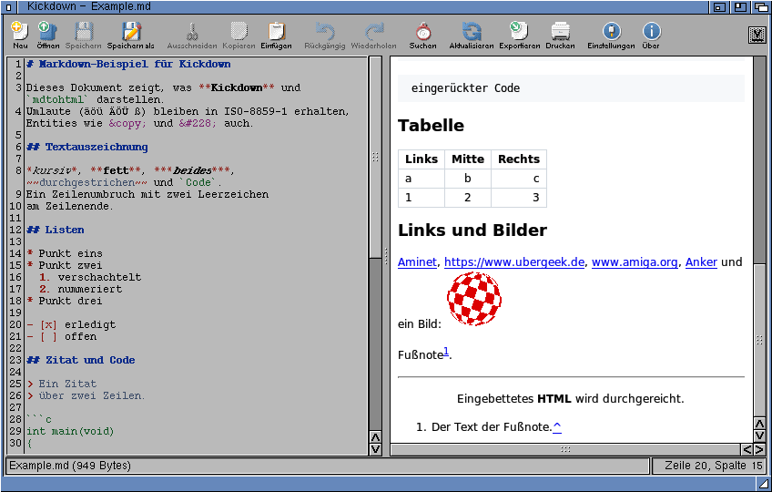
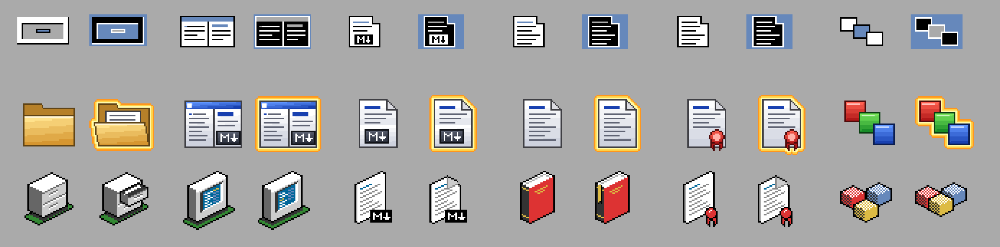

# Amiga-Kickdown

*[English version](README.md)*

Markdown-Werkzeuge für AmigaOS 3.2 in C:

* **Kickdown** – ReAction-basierter Markdown-Editor mit Live-HTML-Vorschau und PostScript-/PDF-Export sowie Bitmap-Druck
* **mdtohtml** – Kommandozeilen-Konverter von Markdown nach HTML

Beide nutzen denselben Konverter auf Basis von [md4c](https://github.com/mity/md4c), einem
schnellen, CommonMark-konformen Parser in C. Sie lösen den ARexx/MUI-Editor und das
Free-Pascal-`mdtohtml` aus [PubAmiga](https://github.com/andregewert/PubAmiga) ab.



*Kickdown unter AmigaOS 3.2: Editor mit Syntax-Hervorhebung, Live-Vorschau*

## Voraussetzungen

* AmigaOS 3.2
* [html.gadget](https://github.com/andregewert/Amiga-HTML-Gadget) 1.2 in `SYS:Classes/Gadgets/` oder neben Kickdown
  (optional `htmlttf.gadget` für TrueType-Schriften)
* [AISS](http://masonicons.info/) für die Toolbar-Bilder (Assign `TBIMAGES:`); ohne zeigen die Knöpfe Text

`mdtohtml` braucht nur die dos.library und läuft auf jedem AmigaOS ab 2.0.

Kickdown und mdtohtml sind darauf ausgelegt, auf echter Hardware und nicht nur im Emulator zu laufen. Ab einer 68030-CPU mit
50 MHz scheint Kickdown recht ordentlich zu funktionieren, ab einem 68040 läuft er recht flüssig. Eine Grafikkarte ist
empfohlen, aber auch auf AGA-Screens funktioniert die Anwendung. Wer große Grafiken einbettet, benötigt entsprechend viel RAM
und eine schnelle CPU.

Die besten Druck-Ergebnisse erhält man mit dem PostScript-Export oder beim Bitmap-Druck aus dem TrueType-Gadget heraus.

Getestete Konfigurationen:
- Amiga 1200 / TF1260 / P-Vision RTG
- Amiga 1200 / Warp1240 / RTG
- Amiga 1200 / Trinity 1260 / AGA
- Amiga 1200 / PiStorm32 lite + CM4 / RTG
- Amiga 2000 / TF536 (68030) / GBAPII++ RTG
- Amiga 4000 / 68060 / ZZ9000 RTG (Treiberversion 1.13 - die neueren Treiber von BlitterStudio funktionieren bei mir gar nicht oder nur fehlerhaft!)

Getestete Drucker:
- Brother DCP-J1140DW via AmiAirPrint (Bitmap-Druck)
- Canon BJC-250 via TurboPrint (PostScript)
- Canon i560 via TurboPrint (PostScript)

## Kickdown

### Funktionen

* Links der Editor (Festbreitenschrift), rechts die HTML-Vorschau, dazwischen ein verschiebbarer Balken.
* Die Vorschau folgt eine halbe Sekunde nach der letzten Eingabe (*Preview/Auto refresh*),
  *Preview/Refresh* (Amiga-R) aktualisiert sofort; die Scrollposition bleibt erhalten.
* Editor und Vorschau scrollen gemeinsam, in beide Richtungen (*Preview/Synchronize scrolling*).
* Syntax-Hervorhebung (*Edit/Syntax highlighting*): Überschriften, Hervorhebungen, Code (auch
  Codeblöcke), Zitate, Listenzeichen, Links, URLs, Tabellen, HTML-Tags und Entities.
  Zeilennummern (*Edit/Line numbers*).
* Die Vorschau sieht ähnlich aus wie auf GitHub: dünne Linien in Tabellen, graue Hintergründe für
  Code, ein Balken bei Zitaten (auch beim Drucken). Große Bilder lassen sich auf ihre Breite
  verkleinern (`FITIMAGES`).
* Überschriften erhalten Anker wie auf GitHub (`## Zwei Worte` → `#zwei-worte`), damit
  Inhaltsverzeichnisse funktionieren.
* Links: `#anker` scrollen die Vorschau, Links auf `.md`-Dateien öffnen diese im Editor (`datei.md#anker`
  springt auch zum Anker, `../` funktioniert), andere
  Links erscheinen in der Statuszeile. Relative Bildpfade beziehen sich auf die Schublade des Dokuments.
* Öffnen, Speichern, Speichern als, HTML exportieren; Rückfrage vor dem Verwerfen von Änderungen
  und vor dem Überschreiben.
* Ausschneiden/Kopieren/Einfügen/Rückgängig/Wiederholen, alles markieren; Markierungen in der
  Vorschau lassen sich ebenfalls kopieren.
* Suchen und Ersetzen (*Edit/Find...*, Amiga-F) in einem Fenster neben dem Editor: Groß-/Klein-
  schreibung, ganze Wörter, rückwärts, Umlauf; „Replace all“ ist ein Rückgängig-Schritt.
  *Find next* (Amiga-G).
* Formatierung (Toolbar und Menü *Format*): Überschrift (jeder Klick eine Ebene mehr, nach `###`
  wieder Text), fett, kursiv, unterstrichen (`<u>`, Markdown kennt das nicht), Code (mehrere Zeilen werden ein Codeblock),
  Link, Bild, Aufzählung, nummerierte Liste, Aufgabenliste, Zitat. Inline-Formate umschließen die
  Markierung oder werden entfernt, wenn sie schon vorhanden sind; fett, kursiv und unterstrichen
  über mehrere Zeilen formatieren jede Zeile einzeln hinter ihrem Listen-, Zitat- oder
  Überschriftenzeichen; Listenformate gelten für alle markierten Zeilen. Jeder Befehl ist ein
  Rückgängig-Schritt.
* Drucken (*Project/Print...*, Amiga-P): auf den Standarddrucker als Grafik mit den Schriften der
  Vorschau (Auflösung nach der Dichte in Prefs/PrinterGfx), als **PostScript** (Level 2, oder 1 für alte Drucker) in eine Datei, nach `PRT:`,
  `PS:` (TurboPrint) oder an ein Gerät, oder als **PDF**. Papierformat, Ränder, Schrift und Größe
  für PostScript/PDF, Seitenzahlen, Hintergrundfarben, Seitenbereich, Kopien; ein
  Fortschrittsfenster kann abbrechen. Mit TurboPrint druckt Kickdown nur über PostScript.
* Einstellungsfenster (*Project/Settings...*): Editor, Preview, Markdown, Colours, Window
  („Current“ übernimmt die Größe des offenen Fensters) und Toolbar. *Save* schreibt sie in die
  Tooltypes des Kickdown-Icons, *Use* gilt für die laufende Sitzung.
* Toolbar mit Bildern, Bildern und Text oder nur Text; die Formatierungsknöpfe lassen sich
  einblenden (*Format/Show formatting buttons*). Knöpfe werden ausgegraut, wenn sie nichts
  bewirken würden (Speichern, Rückgängig/Wiederholen, Ausschneiden/Kopieren), haben Hilfe-Bubbles, und was nicht passt, steht hinter dem Pfeil am rechten Ende.
* Startfenster, solange das Programm startet, Statuszeile mit Cursorposition, das Mausrad
  scrollt den Bereich unter dem Mauszeiger.
* AppWindow: ein auf das Fenster gezogenes Markdown-Icon wird geöffnet. Ikonifizieren
  (Gadget in der Titelleiste oder *Project/Iconify*): ein Doppelklick auf das Kickdown-Icon oder
  ein darauf gezogenes Markdown-Icon öffnet das Fenster wieder.

### Aufruf

```
Kickdown [FILE] <name.md> [TEMPLATE <datei>] [CHARSET <name>] [DIALECT GitHub|CommonMark] [TTF]
         [FONTSET Vera|DejaVu|Noto] [SIZE n] [NOAUTOREFRESH] [NOSYNC] [NOHIGHLIGHT] [LINENUMBERS]
```

Kickdown als Standardprogramm der `.md`-Icons eintragen, dann öffnet ein Doppelklick sie.

### Einstellungen (Tooltypes)

Die Einstellungen kommen aus den Tooltypes des Kickdown-Icons, auch beim Start aus der Shell;
Shell-Argumente und Tooltypes eines Projekt-Icons gehen vor. Beim Speichern bleiben andere
Tooltypes des Icons unverändert.

| Tooltype | Bedeutung |
|---|---|
| `TEMPLATE=datei` | HTML-Template für Vorschau und Export (siehe unten); relativ zur Schublade des Icons |
| `CHARSET=name` | Zeichensatz, der in die Seite geschrieben wird (Standard: erkannt, siehe mdtohtml) |
| `DIALECT=GitHub\|CommonMark` | Markdown-Dialekt (Standard GitHub) |
| `TTF`, `FONTSET=Vera\|DejaVu\|Noto`, `SIZE=n` | Vorschau mit htmlttf.gadget, Schriftfamilie und -größe |
| `NOAUTOREFRESH` | Vorschau nur mit *Preview/Refresh* |
| `NOSYNC` | Editor und Vorschau scrollen getrennt |
| `FITIMAGES` | Große Bilder auf die Breite der Vorschau verkleinern, auch beim Druck (abgeschaltet: braucht auf langsameren Amigas Zeit) |
| `NOHIGHLIGHT`, `LINENUMBERS` | Keine Syntax-Hervorhebung; Zeilennummern zeigen |
| `WIDTH=n`, `HEIGHT=n`, `LEFT=n`, `TOP=n` | Größe und Position des Fensters beim Start |
| `TOOLBAR=IMAGES\|BOTH\|TEXT` | Toolbar-Knöpfe mit Bildern (Standard), Bildern und Text oder nur Text (ab dem nächsten Start) |
| `TOOLBARFRAMES`, `FORMATBUTTONS` | Rahmen um die Knöpfe; Formatierungsknöpfe zeigen |
| `NOSPLASH` | Kein Startfenster |
| `PRINT_MODE=PRINTER\|PS\|PDF` | Art der Ausgabe (Standard: der Drucker; mit TurboPrint PostScript Level 2 nach `PS:`, nie der Drucker) |
| `PS_LEVEL=1\|2` | PostScript-Level (Standard 2) |
| `PRINT_IMAGEDPI=n` | PostScript/PDF: Bilder mit höchstens so vielen dpi (0 = wie im Bild) |
| `PRINT_TO=FILE\|PRT\|PS\|DEVICE`, `PRINT_DEVICE=name` | Wohin PostScript geht |
| `PAPER=A4\|A5\|LETTER\|LEGAL` | Papierformat (Standard A4) |
| `MARGINS=links,oben,rechts,unten` | Ränder in mm (Standard 20); der Drucker fügt eigene hinzu |
| `PRINT_SERIF`, `PRINT_SIZE=n` | PostScript/PDF: Serifenschrift, Schriftgröße (Standard 10) |
| `NOPAGENUMBERS`, `NOPRINTBACKGROUNDS` | Ohne Seitenzahlen, ohne Hintergrundfarben drucken |
| `COLOR_HEADING=RRGGBB` … | Farben der Syntax-Hervorhebung: `COLOR_HEADING`, `COLOR_CODE`, `COLOR_QUOTE`, `COLOR_MARKER`, `COLOR_LINK`, `COLOR_URL`, `COLOR_HTML` |

## mdtohtml

```
mdtohtml [FROM|FILE] <datei.md> [TO|OUTFILE <datei.html>] [TEMPLATE <datei>]
         [CHARSET|ENCODING <name>] [TITLE <text>] [DIALECT|MODE GitHub|CommonMark]
```

| Option | Bedeutung |
|---|---|
| `FROM` | Markdown-Datei; ohne wird von der Standardeingabe gelesen (z. B. `mdtohtml <readme.md >readme.html`) |
| `TO` | HTML-Datei; ohne geht die Seite auf die Standardausgabe |
| `TEMPLATE` | HTML-Template (siehe unten) |
| `CHARSET` | Zeichensatz, der in die Seite geschrieben wird; der Text wird nicht umkodiert. Standard: `UTF-8`, wenn die Eingabe gültiges UTF-8 mit Nicht-ASCII-Zeichen ist, sonst `ISO-8859-1` |
| `TITLE` | Seitentitel; Standard ist die erste `#`-Überschrift, sonst der Dateiname (`Untitled` bei der Standardeingabe) |
| `DIALECT` | `GitHub` (Standard, auch `GFM`: Tabellen, Durchstreichen, Aufgabenlisten, Autolinks, Fußnoten) oder `CommonMark` |

HTML im Markdown-Text wird unverändert übernommen. Die Pascal-Version hatte Unix-Optionen
(`-f`, `-o`, `-t` …); `FILE`, `OUTFILE`, `ENCODING` und `MODE` bleiben als Aliase erhalten.

### Ganze Verzeichnisse

```
mdtohtml FROM <verzeichnis> ALL TO <verzeichnis> [TEMPLATE <datei>] [CHARSET <name>] [DIALECT <name>]
```

Mit `ALL` wird aus einem Baum von Markdown-Dateien ein Baum von HTML-Seiten mit denselben Namen
und Verzeichnissen, zum Beispiel eine Hilfe für den HelpViewer. `TO` wird angelegt, wenn es fehlt;
das übergeordnete Verzeichnis muss vorhanden sein.

* `.md`- und `.markdown`-Dateien werden zu `.html`-Seiten, Titel ist die erste `#`-Überschrift,
  sonst der Dateiname. Andere Dateien werden kopiert, auch fertige `.html`-Seiten. Icons (`.info`)
  und Verzeichnisse, die mit einem Punkt beginnen (`.git`), bleiben außen vor.
* Links zwischen den Dateien schreibt man wie gewohnt, `[Suchen](projekt/suchen.md#optionen)`;
  danach führen sie auf die Seiten. Roh-HTML wird nur als `<a href="...">` und ``
  erkannt, Links in kopierten `.html`-Seiten werden nicht angesehen.
* Danach meldet das Programm tote Links und Anker sowie Dateien im Ziel ohne Quelle (etwa eine
  umbenannte Seite). Das sind Warnungen (Rückgabewert 5). Gelöscht wird nie etwas, solche Dateien
  entfernt man selbst.

### Templates

Ein Template ist eine HTML-Datei mit den Platzhaltern `$title$`, `$encoding$` (oder `$charset$`)
und `$body$` (Groß-/Kleinschreibung egal), siehe `test/template.html`. Ohne Template wird ein
minimaler HTML-4-Rahmen benutzt. Kickdown verwendet das Template für Vorschau und Export.

`$root$` ist für Bilder, die alle Seiten teilen, etwa ``: Mit `ALL`
ist es der Weg von der Seite hinauf zur Wurzel des Baums (`../` je Verzeichnis), sonst, also auch
in Kickdown, ist es leer.

## Sprachen

Englisch ist eingebaut, Deutsch kommt als Katalog (`Catalogs/deutsch/Kickdown.catalog`).
Kickdown findet Kataloge neben dem Programm (`PROGDIR:Catalogs`) oder in `LOCALE:Catalogs`; der
Installer kopiert die ausgewählten.

Eine neue Übersetzung ist eine Datei `catalogs/<sprache>.ct` zu `catalogs/Kickdown.cd` (Format von
CatComp und FlexCat, z. B. als Kopie von `deutsch.ct`) und eine Auswahl in `package/Install`.
`make` lehnt Übersetzungen ab, deren Platzhalter (`%s`, `%lu` …) vom Original abweichen.

## Icons

Das Archiv hat klassische Icons; vollständige Sätze im **GlowIcons**- und **NewIcons**-Stil
liegen in `Icons/` (Doppelklick auf `UseGlowIcons`, `UseNewIcons` oder `UseClassic`).



## Bauen

Benötigt [bebbos amiga-gcc](https://codeberg.org/bebbo/amiga-gcc) unter `/opt/amiga` (mit NDK 3.2)
und Python 3. md4c, die Header von html.gadget und die gemeinsamen Build-Werkzeuge
([amiga-devkit](https://github.com/andregewert/Amiga-Devkit)) sind Git-Submodules.

```
git clone --recursive <repository>     # oder: git submodule update --init
make                # bin/Kickdown, bin/mdtohtml, Kataloge
make check          # Tests auf dem Host
make dist           # Aminet-Archiv dist/Kickdown.lha
make icons          # Beispiel-Icons in icons/
```

Die Amiga-Quellen sind ISO-8859-1 kodiert. Technische Hinweise für Entwickler stehen in
`TECHNICAL.md`, die Konventionen in `CLAUDE.md`.

## Lizenz

MIT, siehe [LICENSE](LICENSE). md4c steht ebenfalls unter MIT (`md4c/LICENSE.md`).
