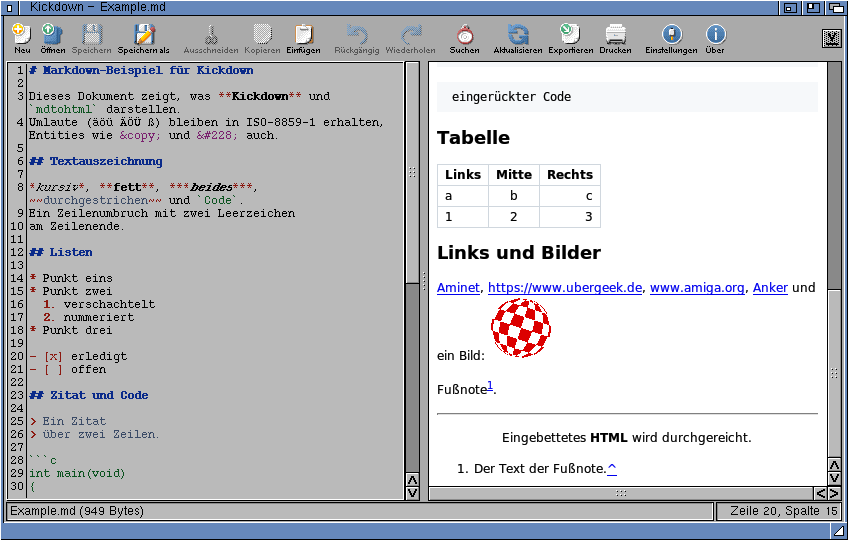
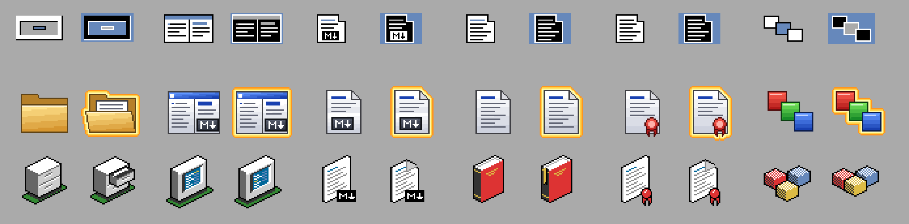

# Amiga-Kickdown

*[Deutsche Version](README.de.md)*

Markdown tools for AmigaOS 3.2, written in C:

* **Kickdown** – a ReAction based Markdown editor with live HTML preview, PostScript/PDF export and bitmap printing
* **mdtohtml** – a command line converter from Markdown to HTML

Both share the same converter built on [md4c](https://github.com/mity/md4c), a fast
CommonMark compliant parser written in C. They replace the earlier ARexx/MUI editor and the
Free Pascal based `mdtohtml` from [PubAmiga](https://github.com/andregewert/PubAmiga).



*Kickdown on AmigaOS 3.2 (German catalog): editor with syntax highlighting, live preview*

## Requirements

* AmigaOS 3.2
* [html.gadget](https://github.com/andregewert/Amiga-HTML-Gadget) 1.2 in `SYS:Classes/Gadgets/` or next to Kickdown
  (optionally `htmlttf.gadget` for TrueType fonts)
* [AISS](http://masonicons.info/) for the toolbar images (`TBIMAGES:` assign); without it the buttons show text

`mdtohtml` only needs dos.library and runs on any AmigaOS from 2.0.

Kickdown and mdtohtml are meant to run on real hardware, not only in an emulator. From a 68030 CPU
at 50 MHz Kickdown seems to work quite well, from a 68040 it runs quite smoothly. A graphics card is
recommended, but the program works on AGA screens as well. Embedding big pictures needs plenty of RAM
and a fast CPU.

The best print results come from the PostScript export or from bitmap printing with the TrueType gadget.

Tested configurations:
- Amiga 1200 / TF1260 / P-Vision RTG
- Amiga 1200 / Warp1240 / RTG
- Amiga 1200 / Trinity 1260 / AGA
- Amiga 1200 / PiStorm32 lite + CM4 / RTG
- Amiga 2000 / TF536 (68030) / GBAPII++ RTG
- Amiga 4000 / 68060 / ZZ9000 RTG (driver version 1.13 - the newer drivers from BlitterStudio do not work at all or only with errors for me!)

Tested printers:
- Brother DCP-J1140DW via AmiAirPrint (bitmap printing)
- Canon BJC-250 via TurboPrint (PostScript)
- Canon i560 via TurboPrint (PostScript)

## Kickdown

### Features

* Editor (fixed width font) on the left, HTML preview on the right, a weight bar between them.
* The preview follows the text half a second after you stop typing (*Preview/Auto refresh*),
  *Preview/Refresh* (Amiga-R) updates it at once; the scroll position is kept.
* Editor and preview scroll together, in both directions (*Preview/Synchronize scrolling*).
* Syntax highlighting (*Edit/Syntax highlighting*): headings, emphasis, code spans and blocks,
  quotes, list markers, links, URLs, tables, HTML tags and entities. Line numbers (*Edit/Line numbers*).
* The preview looks much like GitHub: thin lines in tables, grey backgrounds for code, a bar
  for quotes (also when printing). Big pictures can be scaled down to its width (`FITIMAGES`).
* Headings get GitHub style anchors (`## Two Words` → `#two-words`), so tables of contents work.
* Links: `#anchors` scroll the preview, links to `.md` files open them in the editor (`file.md#anchor`
  also scrolls to the anchor, `../` works), other
  links are shown in the status line. Relative image paths are relative to the document's drawer.
* Open, Save, Save as, Export HTML; asks before discarding changes or replacing files.
* Cut/Copy/Paste/Undo/Redo, select all; text selected in the preview can be copied, too.
* Find and replace (*Edit/Find...*, Amiga-F) in a window next to the editor: case sensitive,
  whole words, backwards, wrap around; Replace all is one undo step. *Find next* (Amiga-G).
* Formatting (toolbar and *Format* menu): heading (every click one level more, after `###` back
  to text), bold, italic, underline (`<u>`, Markdown has none), code (several lines become a code block), link,
  image, bulleted, numbered and task list, quote. Inline formats wrap the selection or are
  removed if it already has them; bold, italic and underline over several lines format each line
  after its list, quote or heading marker; list formats work on all selected lines. Each command
  is one undo step.
* Print (*Project/Print...*, Amiga-P): to the default printer as graphics with the fonts of the
  preview (resolution from the density in Prefs/PrinterGfx), as **PostScript** (level 2, or 1 for old printers) to a file, `PRT:`, `PS:`
  (TurboPrint) or any device, or as **PDF**. Paper size, margins, font and size for
  PostScript/PDF, page numbers, background colours, page range, copies; a progress window
  can stop it. With TurboPrint, Kickdown prints through PostScript only.
* Settings window (*Project/Settings...*): Editor, Preview, Markdown, Colours, Window ("Current"
  takes the size of the open window) and Toolbar. *Save* writes them into the tool types of the
  Kickdown icon, *Use* keeps them for this session.
* Toolbar with images, images and text, or text only; the formatting buttons can be shown
  (*Format/Show formatting buttons*). Buttons are ghosted when they would do nothing (Save,
  Undo/Redo, Cut/Copy), have help bubbles, and those that do not fit are listed under the arrow at the right end.
* Splash window while the program starts, status line with the cursor position, the mouse
  wheel scrolls the pane under the pointer.
* AppWindow: drop a Markdown icon on the window to open it. Iconify (title bar gadget or
  *Project/Iconify*): a double click on the Kickdown icon, or a Markdown icon dropped on it,
  opens the window again.

### Usage

```
Kickdown [FILE] <name.md> [TEMPLATE <file>] [CHARSET <name>] [DIALECT GitHub|CommonMark] [TTF]
         [FONTSET Vera|DejaVu|Noto] [SIZE n] [NOAUTOREFRESH] [NOSYNC] [NOHIGHLIGHT] [LINENUMBERS]
```

Set Kickdown as default tool of your `.md` icons to open them by double click.

### Settings (tool types)

The settings are read from the tool types of the Kickdown icon, also when Kickdown is started from
the Shell; Shell arguments and the tool types of a project icon take precedence. Saving leaves
other tool types of the icon alone.

| Tool type | Meaning |
|---|---|
| `TEMPLATE=file` | HTML template for preview and export (see below); relative to the icon's drawer |
| `CHARSET=name` | Charset written into the page (default: guessed, see mdtohtml) |
| `DIALECT=GitHub\|CommonMark` | Markdown dialect (default GitHub) |
| `TTF`, `FONTSET=Vera\|DejaVu\|Noto`, `SIZE=n` | Preview with htmlttf.gadget, its font family and size |
| `NOAUTOREFRESH` | Preview only on *Preview/Refresh* |
| `NOSYNC` | Editor and preview scroll on their own |
| `FITIMAGES` | Scale big pictures down to the preview width, also when printing (off by default: takes time on slower Amigas) |
| `NOHIGHLIGHT`, `LINENUMBERS` | No syntax highlighting; show line numbers |
| `WIDTH=n`, `HEIGHT=n`, `LEFT=n`, `TOP=n` | Size and position of the window at the start |
| `TOOLBAR=IMAGES\|BOTH\|TEXT` | Toolbar buttons with images (default), images and text, or text only (from the next start) |
| `TOOLBARFRAMES`, `FORMATBUTTONS` | Frames around the buttons; show the formatting buttons |
| `NOSPLASH` | No splash window |
| `PRINT_MODE=PRINTER\|PS\|PDF` | Kind of output (default: the printer; with TurboPrint PostScript level 2 to `PS:`, never the printer) |
| `PS_LEVEL=1\|2` | PostScript level (default 2) |
| `PRINT_IMAGEDPI=n` | PostScript/PDF: pictures with at most this many dpi (0 = as they are) |
| `PRINT_TO=FILE\|PRT\|PS\|DEVICE`, `PRINT_DEVICE=name` | Where PostScript goes |
| `PAPER=A4\|A5\|LETTER\|LEGAL` | Paper size (default A4) |
| `MARGINS=left,top,right,bottom` | Margins in mm (default 20); the printer adds its own |
| `PRINT_SERIF`, `PRINT_SIZE=n` | PostScript/PDF: serif font, font size (default 10) |
| `NOPAGENUMBERS`, `NOPRINTBACKGROUNDS` | Print without page numbers, without background colours |
| `COLOR_HEADING=RRGGBB` … | Colours of the syntax highlighting: `COLOR_HEADING`, `COLOR_CODE`, `COLOR_QUOTE`, `COLOR_MARKER`, `COLOR_LINK`, `COLOR_URL`, `COLOR_HTML` |

## mdtohtml

```
mdtohtml [FROM|FILE] <file.md> [TO|OUTFILE <file.html>] [TEMPLATE <file>]
         [CHARSET|ENCODING <name>] [TITLE <text>] [DIALECT|MODE GitHub|CommonMark]
```

| Option | Meaning |
|---|---|
| `FROM` | Markdown file; without it standard input (e.g. `mdtohtml <readme.md >readme.html`) |
| `TO` | HTML file; without it standard output |
| `TEMPLATE` | HTML template (see below) |
| `CHARSET` | Charset written into the page; the text is not converted. Default: `UTF-8` if the input is valid UTF-8 with non-ASCII characters, otherwise `ISO-8859-1` |
| `TITLE` | Page title; default the first `#` heading, else the file name (`Untitled` for standard input) |
| `DIALECT` | `GitHub` (default, also `GFM`: tables, ~~strikethrough~~, task lists, autolinks, footnotes) or `CommonMark` |

Raw HTML in the Markdown text is passed through. The Free Pascal version used Unix style options
(`-f`, `-o`, `-t` ...); `FILE`, `OUTFILE`, `ENCODING` and `MODE` are kept as aliases.

### Whole drawers

```
mdtohtml FROM <drawer> ALL TO <drawer> [TEMPLATE <file>] [CHARSET <name>] [DIALECT <name>]
```

With `ALL` a tree of Markdown files becomes a tree of HTML pages with the same names and
drawers, for example a help for HelpViewer. `TO` is made if it is missing, its parent must exist.

* `.md` and `.markdown` files become `.html` pages, the first `#` heading is the title, otherwise
  the file name. Other files are copied, also ready-made `.html` pages. Icons (`.info`) and drawers
  starting with a dot (`.git`) are left out.
* Links between the files are written as usual, `[Find](project/find.md#options)`, and lead to
  the pages afterwards. Raw HTML is only recognised as `<a href="...">` and ``,
  and links inside copied `.html` pages are not looked at.
* Afterwards dead links and anchors are reported, and files of the target without a source
  (a page that was renamed, for example). These are warnings (return code 5). Nothing is ever
  deleted, remove such files yourself.

### Templates

A template is an HTML file with the placeholders `$title$`, `$encoding$` (or `$charset$`) and
`$body$` (case is ignored), see `test/template.html`. Without a template a minimal HTML 4 frame
is used. Kickdown uses the template for the preview and the export.

`$root$` is for pictures all pages share, such as ``: with `ALL` it
is the way from the page up to the root of the tree (`../` per drawer), otherwise, and so also in
Kickdown, it is empty.

## Languages

English is built in, German comes as catalog (`Catalogs/deutsch/Kickdown.catalog`). Kickdown
finds catalogs next to the program (`PROGDIR:Catalogs`) or in `LOCALE:Catalogs`; the Installer
copies the ones you select.

A new translation is a `catalogs/<language>.ct` file for `catalogs/Kickdown.cd` (format of CatComp
and FlexCat, e.g. a copy of `deutsch.ct`) and a choice in `package/Install`. `make` refuses
translations whose format specifiers (`%s`, `%lu` …) differ from the original.

## Icons

The archive comes with classic icons; complete sets in the **GlowIcons** and **NewIcons**
style are in `Icons/` (double click `UseGlowIcons`, `UseNewIcons` or `UseClassic`).



## Building

Requires [bebbo's amiga-gcc](https://codeberg.org/bebbo/amiga-gcc) in `/opt/amiga` (with NDK 3.2)
and Python 3. md4c, the html.gadget headers and the shared build tools
([amiga-devkit](https://github.com/andregewert/Amiga-Devkit)) are git submodules.

```
git clone --recursive <repository>     # or: git submodule update --init
make                # bin/Kickdown, bin/mdtohtml, catalogs
make check          # tests on the host
make dist           # Aminet archive dist/Kickdown.lha
make icons          # sample icons in icons/
```

The Amiga sources are ISO-8859-1 encoded. Technical notes for developers are in `TECHNICAL.md`,
the conventions in `CLAUDE.md`.

## License

MIT, see [LICENSE](LICENSE). md4c is MIT licensed as well (`md4c/LICENSE.md`).
